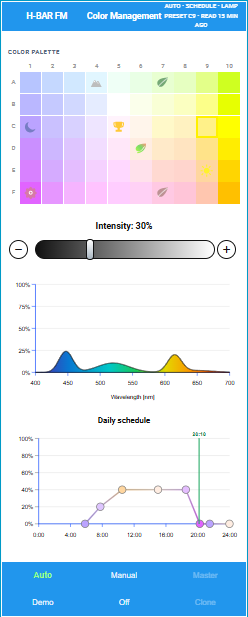

# Skylight Local Card

A standalone Home Assistant Lovelace card for controlling the 60-color preset palette of Skylight H-BAR-FM lamps. Its layout is inspired by the color-control screen in SL Control.

This is a frontend card. It requires the separate [Skylight Local integration](https://github.com/b3cksy/skylight-local) and its preset, power, and mode entities. The integration itself does not include or install this card.



## Features

- Shows the 60 preset colors (`A1`–`F10`) in a grid.
- Highlights the active preset and updates from Home Assistant entity state.
- Controls output power with a slider and plus/minus buttons.
- Provides Auto, Manual, Demo, and Off mode controls.
- Displays current mode, preset, and recent status information.
- Plots the schedule stored in the lamp, with a live line marking the current time.
- Includes the SL Control spectrum plot for the supported H-BAR-F profile.

## Install as a dashboard resource

1. Download `skylight-color-card.js` from this repository.
2. Copy it to Home Assistant's `/config/www/` directory. With the File Editor add-on, this is usually shown as `homeassistant/www/`.
3. In **Settings → Dashboards → Resources**, add `/local/skylight-color-card.js` as a JavaScript module.
4. Add a manual card to a dashboard using YAML mode:

```yaml
type: custom:skylight-color-card
name: Color management
entity: select.skylight_local_preset
power_entity: number.skylight_local_power
mode_entity: select.skylight_local_mode
schedule_entity: sensor.skylight_local_schedule_data
```

Replace entity IDs if Home Assistant assigned different IDs to your lamp. `mode_entity` is optional if the card can find the matching mode selector for the same lamp. `schedule_entity` is optional if the card can find the schedule sensor automatically.

## Requirements and scope

- Home Assistant with Lovelace custom resources enabled.
- The [Skylight Local integration](https://github.com/b3cksy/skylight-local) installed and configured.
- The spectrum profile and preset names currently target the H-BAR-FM (`H-BAR-F`) lamp. Other lamp models are not verified.

## License

MIT. See [LICENSE](LICENSE).
